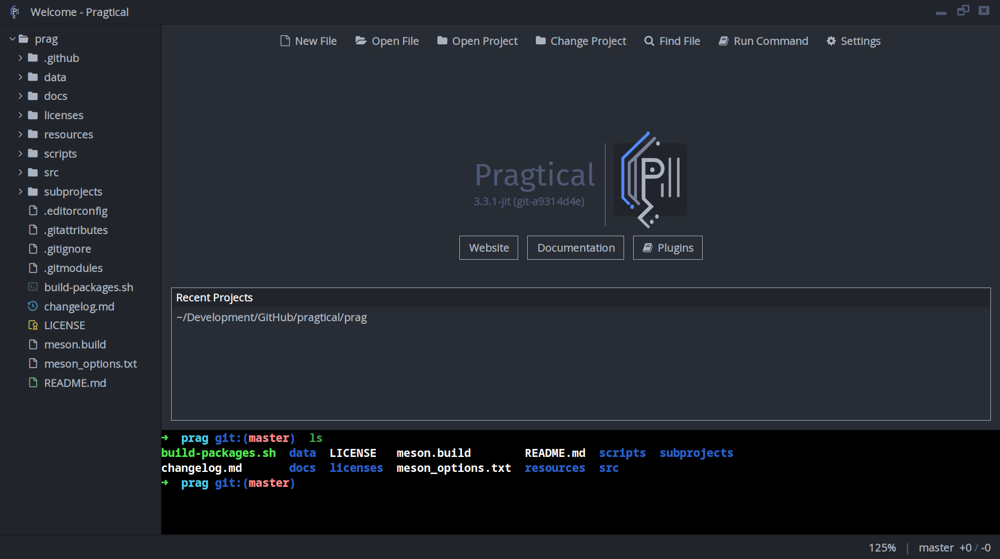

# pragtical-terminal

`pragtical-terminal` is a (mostly) fully-featured terminal emulator designed to
slot into pragtical as a plugin for windows (Windows 10+ only), mac and linux.



## Description

A simple, and straightforward integrated terminal that presents itself as
`xterm-256color`. Supports:

1. A configurable-length scrollback buffer.
2. Alternate buffer support for things like `vim` and `htop`.
3. ANSI colors that follow the active Pragtical color scheme.
4. Signal characters.
5. Configurable shell.
6. Selecting from terminal.
7. Copying from terminal.
8. UTF-8 support.
9. Terminal resizing.
10. Locked scrollback regions.
11. And more!

Windows uses `%COMSPEC%` by default, falling back to `C:\Windows\System32\cmd.exe`.
Linux and macOS use `$SHELL`, falling back to `sh`. Set `config.plugins.terminal.shell`
to choose a different shell.

### Usage

`Alt+T` shows or hides the terminal drawer. `Alt+Shift+T` opens or focuses it.
Hiding the drawer keeps the shell running.

While the terminal has focus, shortcuts such as `Alt+X` and `Alt+M` go to the
running application. The editor's command-palette and tab-switching shortcuts
remain available.

Terminal text, background, cursor, and the first 16 ANSI colors follow the
current editor theme, including when you switch themes in an open terminal.
Programs can also use the standard 256-color palette and explicit RGB colors.
The **Minimum Contrast Ratio** setting defaults to zero to preserve those colors.
Raise it if you need more contrast between text and its background.

You can also put a `TerminalView` into your main viewing pane by using ``ctrl+shift+` ``
or by running the `Terminal: Open Tab` command. It can be closed with `ctrl+shift+w`.

| Command | What it does |
| --- | --- |
| `terminal:run-command-in-tab` | Opens a new interactive shell tab and enters a command. The shell stays available when the command finishes. |
| `terminal:run-command-in-drawer` | Shows and focuses the shared drawer and enters a command there. Use it when the drawer is at a shell prompt. |
| `terminal:spawn-agent` | Runs a command such as `codex` as the main process of a dedicated terminal tab. The tab keeps its output and shows the exit status by default. |
| `terminal:clear` | Clears the active screen and scrollback. A partially typed shell command remains pending. |
| `terminal:reset` | Clears both screens and scrollback and restores the terminal's input and display modes. The running process stays alive. |

The first three commands prompt for shell input when selected from the command
palette. Plugins can supply the command directly, for example
`command.perform("terminal:run-command-in-tab", "git status")`.
**Settings → Plugins → Terminal → Agent Close on Exit** controls whether
agent tabs stay open, close on success, or close after any exit.

Most commands that would normally be bound to `ctrl+<key>` in the editor
can be accessed by `ctrl+shift+<key>` when the terminal has focus.

### Supported Shells

The following shells are tested on each release to ensure that they actually
function:

* bash (Linux/Mac/Windows 10+)
* dash (Linux/Mac)
* zsh (Linux/Mac)
* cmd.exe (Windows 10+)

More shells should work, but are not tested outright.

## Installation

The easiest way to install `pragtical-terminal` is to use
[`ppm`](https://github.com/pragtical/plugin-manager), and then run the
following command:

```
ppm install terminal
```

If you want to simply try it out, you can use `ppm`'s `run` command:

```
ppm run terminal
```

If you want to grab it directly, and build it from the repo, on Linux, Mac
or MSYS on Windows you can do:

```
git clone --depth=1 https://github.com/pragtical/terminal.git \
  --recurse-submodules --shallow-submodules && cd terminal && \
  ./build.sh && cp -R plugins/terminal ~/.config/pragtical/plugins && \
  cp libterminal.so ~/.config/pragtical/plugins/terminal
```

If you want to install on Windows, but don't have MSYS, you can download
the files directly from our [release](https://github.com/pragtical/terminal/releases/tag/latest)
page, download `libterminal.x86_64-windows.dll`, as well as the Source Code,
copy the entire `plugins/terminal` directory from the source archive into your
Pragtical plugins directory and place the DLL alongside its Lua files.

### Stanalone

If you want to use terminal as a standalone terminal, here's a handy script you can use:

```
PRAGTICAL_SCALE=1 ppm run terminal --config 'config.plugins.treeview=false config.plugins.workspace=false config.always_show_tabs=false local _,_,x,y = system.get_window_size() system.set_window_size(800, 500, x, y) local TerminalView = require "plugins.terminal".class local old_close = TerminalView.close function TerminalView:close() old_close(self) os.exit(0) end core.add_thread(function() command.perform("terminal:open-tab") local node = core.root_view.root_node:get_node_for_view(core.status_view) node:close_view(core.root_view.root_node, core.status_view) end)'
```

## Status

1.0 has been released. It should be functional on Windows 10+, Linux, and
MacOS.

## Building

As this is a native plugin, it requires building. Currently it has no
dependencies other than the native OS libraries for each OS.

### Linux, Mac, and Windows MSYS

```
./build.sh -g
```

### Linux -> Windows

```
CC=x86_64-w64-mingw32-gcc BIN=libterminal.dll ./build.sh -g
```
